# Retained database owner preparation and restore

`with_prepared_owner_bytes_at(bytes, parent, leaf, prepare, work)` restores an original
engine image, transfers its actual open Database into a trusted application wrapper,
and keeps that owner through application preparation, fresh child selection and final
readonly coordination. This is a synchronous native Linux operator API. Private
account/session preparation and complete account/file restoration remain separate.

## Factory and ownership contract

The factory receives the actual restored Database by value and returns an owner
implementing PreparedDatabaseOwner. It must move that same owner into its wrapper
without closing/reopening, detaching, sharing or exporting it through errors or side
channels. The factory is trusted native application code, rather than a sandbox.
The plain Database implements the trait for ordinary native use.

For private schemas, implement the trait on a private adapter around the application
store. Do not implement it on a public account type: the mutable database getter would
expose storage outside that type's session/schema invariants. Public auth work should
receive copied validated metadata only. This increment supplies the core mechanism;
it does not add that private account adapter or claim fresh sessions are already reset
through this new protocol.

`Database::check_directory_owner` compares an explicitly supplied original directory
descriptor with the actual database directory/WAL. It is readonly, exports no owner,
and grants no user permission. A foreign comparison does not poison a healthy owner.
A different restored directory with identical database identity/history cannot stand
in for the actual prepared original.

## Preparation and selection

Verify the complete bounded existing backup before staging. Require an actual private
0700 parent, including permission/special bits, and one1..255-byte leaf without slash,
NUL, dot or dot-dot. Retain the actual original directory and original WAL creator
descriptor before opening the database; its independent file description does not
share the database writer's flock lifetime or file cursor.

The factory may append durable preparation commits. The entire original source prefix,
database identity, actual directory and original WAL inode must remain. Compaction or
replacement is unsupported in this initial protocol. Compare exact acknowledged
prepared bytes through that same original file before advancing its expected length/
timestamp baseline. Sync the prepared WAL, build the checkpoint without closing the
owner, recheck ownership/history/privacy, and publish the complete child atomically
without replacement through the original storage directory publisher and parent sync.

```mermaid
flowchart LR
    V[Verify immutable source] --> S[Create private stage and original WAL]
    S --> O[Open and retain actual database]
    O --> P[Trusted factory appends preparation commits]
    P --> C[Verify prepared history and checkpoint]
    C --> N[Select child and sync parent]
    N --> W[Readonly nested work]
    W --> F[Final original-file proofs and syncs]
    F --> R[Release owner and return]
```

Work starts after child selection with a mutable borrow of the trusted wrapper and
copied prepared Report metadata. Mutability supports existing validated read APIs;
work must preserve the prepared state. Keep an enclosing root private until all its
components are prepared. Nested work may select that enclosing root while this same
original database remains locked. The caller owns enclosing-root selection checks,
aggregate admission and application authorization.

After work, compare the actual directory, original single-link600 WAL, inode, complete
length/mode/timestamps and all bytes against the prepared image in8192-byte chunks.
Repeat acknowledged history and selected-name checks, confirm WAL/parent fsync and
recheck before returning. Moving the original native parent never adopts a replacement
at its old path. Checks are finite observations under trusted native OS ownership,
rather than namespace leases.

## Failures and resources

The outer type is Result<T, PreparedRestoreError<E>>. Factory refusal is Preparation(E)
before selection; private stages may already contain its acknowledged preparation
commits. Core failure is Backup(Error). Work's Result, if chosen as T, is a separate
value requiring explicit propagation. Healthy callback refusal preserves a complete
selected copy. An observed postselection failure is RetainedRestoreUnknown, including
original storage publication uncertainty; drop the unconfirmed value and preserve
selected/foreign files. Never overwrite or silently retry. Nonempty failed stages
are retained without recursive cleanup.

A callback that commits additional writes violates the readonly work contract.
The operation reports uncertainty and preserves those acknowledged writes; it does
not promise rollback of an already committed callback transaction. Existing targets
are never replaced or passed to work, although their conflicting name may be detected
after private preparation. Ordinary restore and restore_prepared entry points keep
their previous protocols and formats.

Input/prepared WALs and replayed snapshots use existing engine/image bounds. Source
bytes, the complete prepared expected WAL, replayed models, checkpoint work, native
descriptors and8192-byte scratch have separate costs. This is not a whole-process
heap/FD reservation, network deadline, authenticated backup origin or encryption.

## Verification

[ADR0159](adr/0159-retained-application-database-preparation.md) records the choice.
[Source-bound verification](measurements/2026-10-15-prepared-owner-restore/verification.json)
records the final matrix and exclusions. Twelve new regular cases include16 generated
empty/nonempty WAL1/2 models, actual owner transfer into an application wrapper and
drop/descriptor counts, direct foreign comparison without poisoning, same-ID/history
foreign-owner and compaction refusal, factory refusal after a durable commit, healthy
work refusal and an explicitly preserved callback commit reported as uncertain.

Forty-eight physical mutation cases cover two WAL versions, three preparation/
selection/work boundaries and eight inode/content/tail/link/privacy/root changes.
Ten injected sync failures span before/after actual input/prepared/stage/confirm
WAL/parent syncs. Bounds/privacy/invalid-image and existing file/directory/link targets
refuse without overwriting;255-byte leaves and moved native parents are exercised.

Twenty-four actual signal9 kills cover source-open, factory-after-commit, prepared,
selected, work-complete and returned boundaries for empty/nonempty WAL1/2 sources.
Original locks and at least two original WAL descriptors span all pre-return phases;
they are absent after return. Private stages or selected copies reopen, distinguish
source-only from prepared history, preserve original source/archive bytes and support
fresh independent restoration. Prepared copies accept their next independent write.

Byte parsers/formats and external dependencies are unchanged. No new sanitizer,
private-account reset, v2 adoption or production acceptance is implied by this core
coordination mechanism.

Final affected suites pass854 cases per Rust1.99/1.89:337 original engine/core,
328 storage/object/file,33 joined components,12 original file publication,
29 registry restore,28 named registry integrations,42 account CLI and45 native CLI.
30 ignored entries are27 parent-invoked process fixtures and three opt-in corpus
generators. Every final process closes with0 and all653 frozen inputs match.
Formatting, strict workspace/fuzz lint, affected builds and minimum fuzz compilation
pass. The increment adds1004 net Rust lines with tests; total source is140039 lines.
The first compile refusal was a missing test-only DirBuilderExt import; corrected
preliminary cases pass12, excluded from final totals. No behavioral prototype
failure was observed in this increment.

Earlier hosted12a3e1b independently passes1801/0/44 on both complete workspace
toolchains and all five jobs, with649 committed source hashes checked. Its58
allocation-diagnostic cases are separate. That earlier complete CI is distinct
from this native owner-preparation source and its targeted verification.

## Subsequent private integration

The [private account adapter](private-account-restore-coordination.md) now supplies
the previously separate account preparation. Its additive guarded factory borrows
a PreparedSourceGuard to prove the untouched original source just before reset,
preventing ordinary tail trimming from hiding an observed pre-reset append. The
original factory API/protocol remains available. A guard exports no descriptor and
cannot acknowledge a preparation commit; final prepared proofs remain mandatory.
